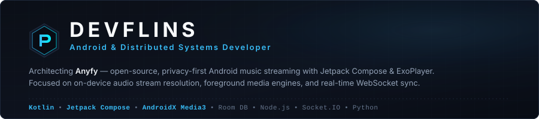

  <!-- Header Banner -->
  

    

  <!-- Status & Quick Badges -->
  
  
  

  

    <b>Architecting high-performance Android media applications, low-latency audio pipelines, and open-source tooling.</b>
  

  

## ⚡ About Me

I am a passionate software engineer focused on building clean, performant, and privacy-respecting client applications and distributed backend services. My primary domain is the **Android ecosystem**, specializing in modern declarative UI (**Jetpack Compose**), media playback engines (**AndroidX Media3 / ExoPlayer**), and real-time synchronized networking.

- 📱 **Core Focus:** Native Android engineering with 100% Kotlin, Jetpack Compose (Material 3), and reactive architectures.
- 🎵 **Media Engineering:** Audio stream resolution, ExoPlayer pipeline management, and background media sessions without external proxy dependencies.
- 🌐 **Real-Time Systems:** Lightweight Node.js and WebSocket microservices for synchronized multi-user audio listening rooms.
- 🛠️ **Engineering Mindset:** Pragmatic, privacy-first design, strictly decoupled architecture, and zero unnecessary bloat.

  

## ⭐ Flagship Project: [Anyfy](https://github.com/devflins2/anyfy)

  <h3>Modern, Privacy-Respecting Android Music Streaming Client</h3>
  
Seamless on-device playback integrated with YouTube Music, synchronized listening rooms, and zero cloud audio proxy dependencies.

  

    
    
    
    
  

| Capability | Engineering Architecture |
| :--- | :--- |
| **Stream Extraction** | On-device audio stream resolution using native stream cipher solvers — eliminates 3rd party audio proxies. |
| **UI & UX** | Modern monochrome interface built entirely with **Jetpack Compose**, Material 3 design tokens, and Coil Compose. |
| **Audio Core** | **AndroidX Media3 (ExoPlayer 1.4+)** foreground service with lockscreen controls, notification actions, and audio focus management. |
| **Realtime Sync** | Synchronized multi-user listening sessions ("Together Listening") coordinated via WebSocket / Socket.IO. |
| **Data Persistence** | Offline-first caching with **Room DB (SQLite)** and Jetpack DataStore preferences. |
| **Release Pipeline** | Production signed APK with automated in-app updater and SHA-256 cryptographic signature verification. |

> 🔗 **Explore Project:** [Repository](https://github.com/devflins2/anyfy) • [Download Release APK](https://github.com/devflins2/anyfy/releases/latest) • [Report Issue](https://github.com/devflins2/anyfy/issues)

  

## 🚀 Public Projects & Repositories

All projects listed below are verified public repositories maintained by **devflins2**:

<table>
  <tr>
    <td width="50%" valign="top">
      <h3><a href="https://github.com/devflins2/socketformusic">socketformusic</a></h3>
      
<b>Real-Time Audio Session WebSocket Server</b>

      
Lightweight Node.js backend providing WebSocket room synchronization and state broadcast for real-time synchronized group listening rooms.

      
      
      
    </td>
    <td width="50%" valign="top">
      <h3><a href="https://github.com/devflins2/animenewspost">animenewspost</a></h3>
      
<b>Automated Content Pipeline &amp; Curator</b>

      
Automated backend worker script for monitoring, parsing, and publishing structured anime news updates to distribution channels.

      
      
    </td>
  </tr>
  <tr>
    <td width="50%" valign="top">
      <h3><a href="https://github.com/devflins2/animeapinews">animeapinews</a></h3>
      
<b>News Feed API Service</b>

      
RESTful microservice designed to serve structured anime news and release metadata in clean JSON endpoints.

      
      
    </td>
    <td width="50%" valign="top">
      <h3><a href="https://github.com/devflins2/user-to-number-">user-to-number-</a></h3>
      
<b>Data Transformation Utility</b>

      
Lightweight utility library for identifier mapping, string normalization, and data processing routines.

      
      
    </td>
  </tr>
</table>

  

## 🛠️ Technology Stack

Verified technologies actively utilized across public repositories:

### 📱 Android & Mobile Engineering

  
  
  
  
  
  

### 🌐 Backend & Distributed Networking

  
  
  
  

### 💻 Programming Languages

  
  
  
  
  

### ⚙️ Build, Tooling & Workflow

  
  
  
  
  

  

## 📊 GitHub Analytics & Activity Metrics

  <!-- Stats Card & Most Used Languages -->
  
  

    

  <!-- Contribution Streak -->
  

    

  <!-- Contribution Activity Graph -->
  

<!-- Graceful Fallback Table for Offline/Slow Connection Environments -->

📋 <b>Verified Activity &amp; Metric Summary (Graceful Text Fallback)</b>

| Metric Dimension | Current Value / Status | Primary Technologies |
| :--- | :--- | :--- |
| **Public Repositories** | 6 Repositories | Kotlin, Python, JavaScript, Shell |
| **Flagship Codebase** | `devflins2/anyfy` (2.4+ MB Kotlin) | Jetpack Compose, Media3, Room, Socket.IO |
| **Primary Languages** | Kotlin, JavaScript, Python | Android SDK, Node.js, Automation |
| **Public Profile** | Active (`devflins2`) | Pushed releases, verified architectures |

  

## 📬 Connect & Collaborate

Have questions about **Anyfy**, real-time audio architectures, or potential collaborations?

  
  
  

 

  Designed &amp; engineered with precision for <b>DEVFLINS2</b> • Dark Charcoal &amp; Electric Cyan Visual Identity

